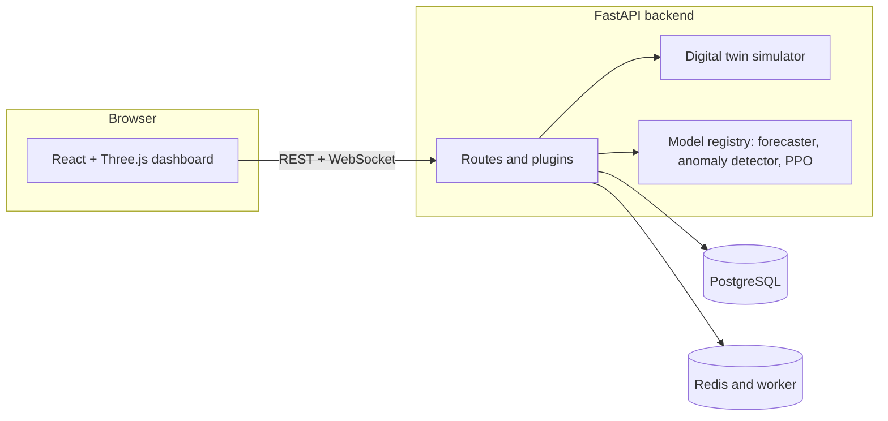

# TwinGrid

**A simulation-based data-centre digital-twin platform.** [C-01] Every number it shows comes from its own simulator. See the
[claims ledger](docs/CLAIMS.md): each `[C-nn]` tag below is a row there with its evidence and its boundary.

## What it is, and what it is not

- It simulates a data centre's IT and cooling power, water use and carbon with a FastAPI backend, and shows it in a React and Three.js dashboard. [C-01]
- Its physics uses engineering values that are not calibrated to any facility. [C-03]
- Carbon uses a flat assumed 475 gCO2/kWh unless a carbon file is loaded; none ships. [C-04]
- The interface labels data as simulated. [C-05]
- It is not connected to any real facility and controls no equipment. [C-02]
- It does not claim that its machine-learning models work on real hardware: they are trained and scored on simulator data. [C-06] [C-07] [C-08]
- Real facility integration, multi-tenancy, SOC 2, Kubernetes, multi-region and real 3D facility import are not built. [C-33]

## Architecture



Details: [system](docs/architecture/system.md), [data flow](docs/architecture/data_flow.md), [extension points](docs/architecture/extension_points.md).

## Quickstart (not timed)

Needs Docker Desktop. On Windows PowerShell, from the repository root:

```powershell
.\scripts\demo.ps1 -WithFrontend
```

It creates `.env.demo` with random local secrets, starts the database, cache and API, seeds simulated data, and prints the
URLs and three demo logins (the passwords are printed once). The API is on `http://localhost:8000` and the dashboard on
`http://localhost:8080`. [C-26] On macOS or Linux use `scripts/demo.sh`. The first run builds an image; how long it takes was
not measured.

Without Docker, the manual path is in [`CONTRIBUTING.md`](CONTRIBUTING.md) and [`DEPLOYMENT.md`](DEPLOYMENT.md): install
`requirements.txt`, run `alembic upgrade head`, start `uvicorn api.main:app`, then in `twin-stream-insight-main` run `npm ci`
and `npm run dev` with `VITE_API_BASE_URL` set (see `twin-stream-insight-main/.env.example`).

## Feature tour

<!-- screenshots: add images under docs/img/ and link them next to each bullet -->

- **Live twin and 3D inspector:** hover and click racks in a simulated facility. [C-10] <!-- screenshot: live twin -->
- **Story Mode, command palette and status bar:** a guided tour, Ctrl or Cmd + K, and a bar showing connection, last update and data origin. [C-16] <!-- screenshot: story mode -->
- **What-if lab:** change load, ambient temperature, setpoint or cooling mode and see the simulated difference and a sensitivity sweep. [C-12] <!-- screenshot: what-if lab -->
- **Replay:** scrub back through stored telemetry and alerts. [C-11] <!-- screenshot: replay -->
- **Executive dashboard:** PUE, energy, carbon and a baseline comparison with plain-language insights. [C-13] <!-- screenshot: executive dashboard -->
- **Alerts centre:** incident workflow with status, assignee, notes and an audit trail. [C-14] <!-- screenshot: alerts centre -->
- **Model Passport:** each model's status and limitations. [C-09] <!-- screenshot: model passport -->
- **Optimizer and approvals:** a rule-based recommendation, a sandbox, and admin approval of proposals; nothing is applied to equipment. [C-15] <!-- screenshot: optimizer -->
- **Fleet view:** five simulated sites ranked by PUE, carbon and simulated alert conditions. [C-17] <!-- screenshot: fleet view -->
- **Reports and export:** a printable report, exports, and a PDF that opens with a simulated-data banner. [C-18] <!-- screenshot: report -->
- **Live feed resilience:** reconnect with jitter and gap back-fill. [C-19]

## What the machine-learning results show

- The thermal forecaster: RMSE 0.523 °C, 30 minutes ahead, on held-out simulator data, with no baseline to compare against. [C-06]
- The anomaly detector: F1 0.96, with a threshold tuned on the rows it is scored on. [C-07]
- The PPO optimizer: scored once under the physics-1 protocol, outcome C, claim allowed: none. A fixed setting scored higher than every PPO seed, so the registered action is to prefer the simpler controller. [C-08]

Read [`docs/model_cards/LIMITATIONS.md`](docs/model_cards/LIMITATIONS.md) before quoting any of these.

## Limitations

- **Simulated.** Every number comes from the project's own simulator; nothing is measured at a facility and no equipment is controlled. [C-35]
- **Lumped model.** The physics is a lumped (whole-room) thermal and energy model, with no per-rack or per-aisle behaviour. [C-35]
- **Assumed carbon.** Carbon is a flat 475 gCO2/kWh assumption, so carbon figures follow energy use, not a grid. [C-35]
- **No calibration.** Parameters are published engineering values, not fitted to any facility. [C-35]
- **Models.** Trained and scored on simulator data only; the forecaster has no baseline, the anomaly threshold saw its own test rows, and PPO did not beat a fixed setting. [C-35]

Details: [`docs/model_cards/LIMITATIONS.md`](docs/model_cards/LIMITATIONS.md), [`docs/PHYSICS_V2.md`](docs/PHYSICS_V2.md).

## Engineering

- Performance work (ETag, gzip, a memoised carbon load, list indexes): micro-benchmarks only. [C-20]
- Sign-in with refresh rotation and three roles. [C-21]
- Security headers, single-use WebSocket tickets and login lockout, unit-tested, not audited. [C-22]
- Structured logs with secret redaction. [C-23]
- Migrations with a single head. [C-28]
- Automated tests and CI configured; a green run of the whole suite on this tree was not seen. [C-32]
- Release pipeline and scanning configured, never run on a real tag. [C-27]
- Accessibility fixes applied; not claimed WCAG-compliant. [C-30]
- Seven runbooks cover common failures; none has been used in a real incident. [C-24]
- The API reference can be regenerated from the code. [C-29]
- The service targets and the frontend performance budgets are unmeasured hypotheses. [C-25] [C-31]

## Links

[Claims ledger](docs/CLAIMS.md) · [Judges pack](docs/JUDGES.md) · [Demo checklist](docs/DEMO_CHECKLIST.md) ·
[Model cards](docs/model_cards/) · [Data truth](docs/model_cards/DATA_TRUTH.md) · [Security](SECURITY.md) ·
[Threat model](docs/security/THREAT_MODEL.md) · [Runbooks](docs/runbooks/README.md) · [SLO hypotheses](docs/SLO.md) ·
[Architecture decisions](docs/adr/) · [Operations](docs/OPERATIONS.md) · [Release process](docs/release/RELEASE_PROCESS.md) ·
[Frontend status](twin-stream-insight-main/docs/frontend/STATUS.md) · [Contributing](CONTRIBUTING.md)

## Status

- Not confirmed by a recorded run: the full test suite on this tree, the PDF report render, an asynchronous optimize job through the worker, migrations on a managed PostgreSQL, and any real deployment. [C-34]

What has and has not been run is recorded in [`twin-stream-insight-main/docs/frontend/STATUS.md`](twin-stream-insight-main/docs/frontend/STATUS.md)
and the per-task reports in [`docs/tasks/`](docs/tasks/).
