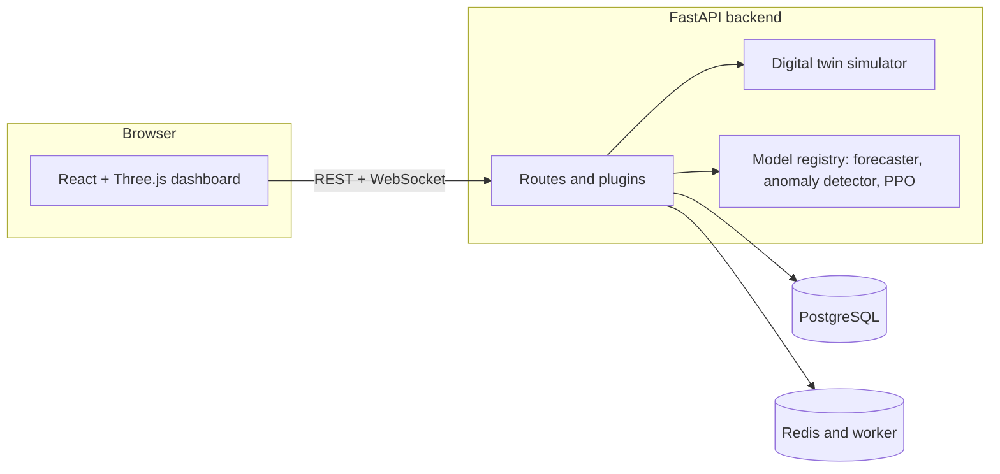

<h1 align="center">TwinGrid</h1>

<p align="center">
  <strong>A simulation-based data-centre digital twin, built to be honest about what it is.</strong><br>
  Simulate IT and cooling power, water and carbon. Explore what-ifs. Read every claim against its evidence.
</p>

<p align="center">
  
  
  
  
  
  
  <a href="LICENSE"></a>
</p>

<p align="center">
  <a href="#quickstart-not-timed">Quickstart</a> ·
  <a href="#feature-tour">Features</a> ·
  <a href="#architecture">Architecture</a> ·
  <a href="#what-the-machine-learning-results-show">ML results</a> ·
  <a href="#limitations">Limitations</a> ·
  <a href="#status">Status</a> ·
  <a href="#links">Docs</a>
</p>

---

**A simulation-based data-centre digital-twin platform.** [C-01] Every number it shows comes from its own simulator. See the
[claims ledger](docs/CLAIMS.md): each `[C-nn]` tag below is a row there with its evidence and its boundary.

## At a glance

| | |
| --- | --- |
| **What it models** | IT and cooling power, water use and carbon for a simulated data centre, behind a FastAPI backend. [C-01] |
| **What you see** | A React and Three.js dashboard: a 3D facility, what-if lab, replay, alerts, reports and a fleet view. [C-10] [C-12] [C-17] |
| **What it will not tell you** | Anything about a real facility: nothing is measured, fitted to a facility or connected, and no equipment is controlled. [C-02] [C-03] |
| **How it stays honest** | Every public claim is a row in the claims ledger with a status, its evidence and a boundary; a test checks the paths exist and the overclaim words stay out. [C-35] |

## What it is, and what it is not

- It simulates a data centre's IT and cooling power, water use and carbon with a FastAPI backend, and shows it in a React and Three.js dashboard. [C-01]
- Its physics uses engineering values that are not calibrated to any facility. [C-03]
- Carbon uses a flat assumed 475 gCO2/kWh unless a carbon file is loaded; none ships. [C-04]
- The interface labels data as simulated. [C-05]
- It is not connected to any real facility and controls no equipment. [C-02]
- It does not claim that its machine-learning models work on real hardware: they are trained and scored on simulator data. [C-06] [C-07] [C-08]
- Real facility integration, multi-tenancy, SOC 2, Kubernetes, multi-region and real 3D facility import are not built. [C-33]

## Feature tour

- **Live twin and 3D inspector:** hover and click racks in a simulated facility. [C-10]
- **Story Mode, command palette and status bar:** a guided tour, Ctrl or Cmd + K, and a bar showing connection, last update and data origin. [C-16]
- **What-if lab:** change load, ambient temperature, setpoint or cooling mode and see the simulated difference and a sensitivity sweep. [C-12]
- **Replay:** scrub back through stored telemetry and alerts. [C-11]
- **Executive dashboard:** PUE, energy, carbon and a baseline comparison with plain-language insights. [C-13]
- **Alerts centre:** incident workflow with status, assignee, notes and an audit trail. [C-14]
- **Model Passport:** each model's status and limitations. [C-09]
- **Optimizer and approvals:** a rule-based recommendation, a sandbox, and admin approval of proposals; nothing is applied to equipment. [C-15]
- **Fleet view:** five simulated sites ranked by PUE, carbon and simulated alert conditions. [C-17]
- **Reports and export:** a printable report, exports, and a PDF that opens with a simulated-data banner. [C-18]
- **Live feed resilience:** reconnect with jitter and gap back-fill. [C-19]

## Architecture



| Layer | Built with |
| --- | --- |
| Backend | Python 3.12, FastAPI, SQLAlchemy (async), Alembic migrations |
| Models | TensorFlow models run in the API (for example the anomaly detector); PyTorch and stable-baselines3 are used only for PPO training and are not in the API image |
| Frontend | React 18, TypeScript, Vite, Tailwind CSS, Three.js, zod contract schemas |
| Data | PostgreSQL, Redis |
| Quality | pytest, ruff, pyrefly, Vitest, Playwright with axe, CodeQL, gitleaks, pip-audit and an npm audit gate |

Details: [system](docs/architecture/system.md), [data flow](docs/architecture/data_flow.md), [extension points](docs/architecture/extension_points.md).

## Quickstart (not timed)

Needs Docker Desktop. On Windows PowerShell, from the repository root:

```powershell
.\scripts\demo.ps1 -WithFrontend
```

It creates `.env.demo` with random local secrets, starts the database, cache and API, seeds simulated data, and prints the
URLs and three demo logins (the passwords are printed once). The API is on `http://localhost:8000` and the dashboard on
`http://localhost:8080`. [C-26] On macOS or Linux use `scripts/demo.sh`.

Before a demo, run `docker ps` and make sure only one TwinGrid stack is up: two stacks fight for port 8000.

Timing: one run of `demo.ps1` after a reset, with image layers cached, took 28.7 s on the owner's machine (single run). The first
build was not measured, and no run of this quickstart from a clean clone has been recorded.

Without Docker, the manual path is in [`CONTRIBUTING.md`](CONTRIBUTING.md) and [`DEPLOYMENT.md`](DEPLOYMENT.md): install
`requirements.txt`, run `alembic upgrade head`, start `uvicorn api.main:app`, then in `twin-stream-insight-main` run `npm ci`
and `npm run dev` with `VITE_API_BASE_URL` set (see `twin-stream-insight-main/.env.example`).

## Access, demo mode and the assistant

These parts are in the code and have tests. They were exercised in browser runs on the owner's machine (see
[the L7 report](docs/roadmap/task-reports/R_L7_REPORT.md)), not in CI, so none of them is in the claims ledger. Per-task detail:
[`docs/roadmap/task-reports/`](docs/roadmap/task-reports/).

- **Viewer access.** The public sign-in screen includes a request form; the API accepts `POST /api/access-requests`, lets the
  requester poll a status with a one-time token, and emails the owner approve/deny links. The flow also has an activation page
  and an admin queue. Mail has been exercised over a local SMTP path and a file outbox, not through a real mailbox.
- **Read-only demo.** The sign-in screen includes an **Explore read-only demo** button, which calls `POST /auth/demo-session`.
  The backend issues a short read-only session only when `DEMO_PUBLIC_ENABLED` is true (length and rate limit:
  `DEMO_SESSION_MINUTES`, `DEMO_SESSION_RATE_LIMIT`); otherwise the UI shows that the demo is unavailable. The demo session may
  ask the assistant. The button and its error/duplicate-click states are covered by `LoginScreen.access.test.tsx`.
- **Assistant ("Explain this").** `POST /api/copilot/ask` answers from templates filled with evidence the server fetched itself
  (alert, signal, model, feature, cited `E1`, `E2`...). The drawer shows the evidence table and what is not known. **No language
  model is connected**, so there is nothing to configure for one, and it cannot write numbers: every figure in an answer is copied
  from an evidence row.
- **Carbon on every new report surface** is labelled assumed unless a dated real series is loaded (`src/carbon_label.py`).

## Configure mail, and run the checks

<details>
<summary><strong>Mail settings</strong></summary>

Mail for access requests is read from the environment at call time: `ACCESS_NOTIFY_BACKEND` (`file` writes to
`ACCESS_NOTIFY_FILE_DIR`, default `reports/dev_outbox`, for development; `smtp` sends), `ACCESS_NOTIFY_SMTP_USER`,
`ACCESS_NOTIFY_SMTP_HOST`, `ACCESS_NOTIFY_SMTP_PORT`, `ACCESS_NOTIFY_SMTP_TLS`, `ACCESS_NOTIFY_OWNER_EMAIL`,
`ACCESS_NOTIFY_FROM` and `ACCESS_PUBLIC_BASE_URL` (`src/notify/settings.py`; `docs/env/` has the full lists). Sending through a real
mailbox has not been tried by the maintainers.

</details>

<details>
<summary><strong>Run all checks</strong> (PowerShell, repository root)</summary>

```powershell
pip install -r requirements.txt -r tests/test_requirements.txt
ruff check .; ruff format --check .; pytest tests/ -q
alembic upgrade head; alembic check
cd twin-stream-insight-main; npm ci; npm run verify; cd ..
```

The backend and frontend suites each have a recorded green run on the owner's machine (see [C-32]). The Playwright specs need the
demo stack running. CI runs the same jobs; on PR #87 every blocking job was green, and `frontend-e2e` is advisory and was red, so a
green run of all of them on one commit is not recorded (see [Status](#status)).

</details>

## What the machine-learning results show

- The thermal forecaster: RMSE 0.523 °C, 30 minutes ahead, on held-out simulator data, with no baseline to compare against. [C-06]
- The anomaly detector: F1 0.96, with a threshold tuned on the rows it is scored on. [C-07]
- The PPO optimizer: scored once under the physics-1 protocol, outcome C, claim allowed: none. A fixed setting scored higher than every PPO seed, so the registered action is to prefer the simpler controller. [C-08]

Read [`docs/model_cards/LIMITATIONS.md`](docs/model_cards/LIMITATIONS.md) before quoting any of these.

## Limitations

- **Simulated.** Every number comes from the project's own simulator; nothing is measured at a facility and no equipment is controlled. [C-35]
- **Lumped model.** The physics is a lumped (whole-room) thermal and energy model, with no per-rack or per-aisle behaviour. [C-35]
- **Assumed carbon.** Carbon is a flat 475 gCO2/kWh assumption, so carbon figures follow energy use, not a grid. [C-35]
- **No calibration.** Parameters are published engineering values, not fitted to any facility. [C-35]
- **Models.** Trained and scored on simulator data only; the forecaster has no baseline, the anomaly threshold saw its own test rows, and PPO did not beat a fixed setting. [C-35]

Details: [`docs/model_cards/LIMITATIONS.md`](docs/model_cards/LIMITATIONS.md), [`docs/PHYSICS_V2.md`](docs/PHYSICS_V2.md).

## Engineering

- Performance work (ETag, gzip, a memoised carbon load, list indexes): micro-benchmarks only. [C-20]
- Sign-in with refresh rotation and three roles. [C-21]
- Security headers, single-use WebSocket tickets and login lockout, unit-tested, not audited. [C-22]
- Structured logs with secret redaction. [C-23]
- Migrations with a single head. [C-28]
- Automated tests and CI configured; the backend suite (5741 passed) and frontend suite (2401 passed) were recorded green on the owner's machine, and CI's blocking jobs were green on PR #87. The browser end-to-end CI job is advisory and was red. [C-32]
- Release pipeline and scanning configured, never run on a real tag. [C-27]
- Accessibility fixes applied; an automated axe run passed 48 of 48; not claimed WCAG-compliant. [C-30]
- Seven runbooks cover common failures; none has been used in a real incident. [C-24]
- The API reference can be regenerated from the code. [C-29]
- The service targets and the frontend performance budgets are unmeasured hypotheses. [C-25] [C-31]

## Status

Readiness assessment from existing evidence, 2026-10-28: **PARTIALLY READY**
([`R_L9_REPORT.md`](docs/roadmap/task-reports/R_L9_REPORT.md)). It can be shown as a simulation-only project on the owner's machine. It
is not claimed as verified end to end in CI, as deployed, or as having a signed accessibility review.

| Area | State | Tag |
| --- | --- | --- |
| Backend tests | 5741 passed, 78 skipped, 0 failed (owner's machine) | [C-32] |
| Frontend tests | 2401 passed (owner's machine) | [C-32] |
| CI, blocking jobs | Green on PR #87; browser end-to-end job advisory and red | [C-32] |
| Accessibility | Automated axe run 48 of 48; manual checks not done | [C-30] |
| Release and scanning | Configured; release pipeline never run on a tag | [C-27] |
| Not run at all | PDF render, async optimize job through the worker, managed PostgreSQL, any real deployment | [C-34] |

- No release-candidate gate has been recorded (playbook Task 31), so there is no release verdict. Per-item evidence or blocker: [`docs/roadmap/EVIDENCE_MATRIX.md`](docs/roadmap/EVIDENCE_MATRIX.md). [C-34]
- No clean-clone install, full failure-drill set or timed demo run has been recorded, so no release verdict is claimed. [C-34]
- Not confirmed by a recorded run: the PDF render, an asynchronous optimize job through the worker, migrations on a managed PostgreSQL, and any real deployment. [C-34]

What has and has not been run is recorded in [`twin-stream-insight-main/docs/frontend/STATUS.md`](twin-stream-insight-main/docs/frontend/STATUS.md)
and the per-task reports in [`docs/tasks/`](docs/tasks/).

## Links

[Claims ledger](docs/CLAIMS.md) · [Judges pack](docs/JUDGES.md) · [Demo checklist](docs/DEMO_CHECKLIST.md) ·
[Model cards](docs/model_cards/) · [Data truth](docs/model_cards/DATA_TRUTH.md) · [Security](SECURITY.md) ·
[Threat model](docs/security/THREAT_MODEL.md) · [Runbooks](docs/runbooks/README.md) · [SLO hypotheses](docs/SLO.md) ·
[Architecture decisions](docs/adr/) · [Operations](docs/OPERATIONS.md) · [Release process](docs/release/RELEASE_PROCESS.md) ·
[Evidence matrix](docs/roadmap/EVIDENCE_MATRIX.md) · [Frontend status](twin-stream-insight-main/docs/frontend/STATUS.md) ·
[Contributing](CONTRIBUTING.md) · [License (GPL-3.0)](LICENSE)
