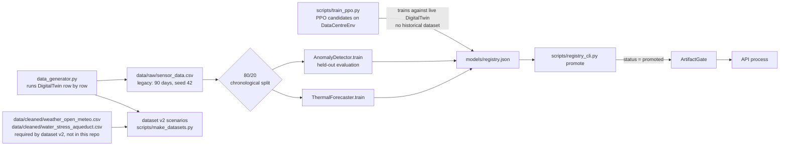
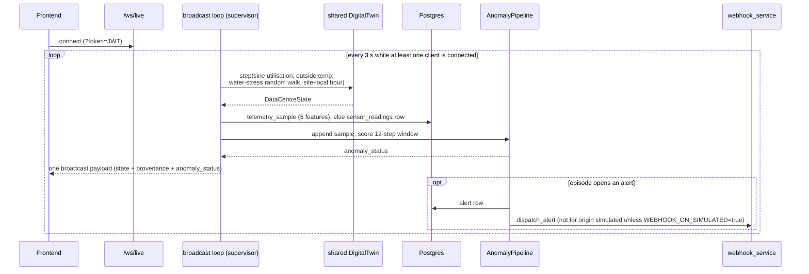

# Data Flow

All data below is **simulated**: it originates in `DigitalTwin` (see
`system.md`). Rows persisted from the live loop carry `origin = "simulated"`.

## Training-time (offline)

- `notebooks/train_all.py` is the legacy end-to-end path: it generates the CSV
  with `generate_sensor_data(days=90, seed=42)`, trains the forecaster
  (`train_ratio=0.8`) and the anomaly detector (chronological 80/20 split,
  evaluated on the held-out 20%), and logs each model with `log_model`.
- Dataset v2 (`generate_scenario`, driven by `configs/splits/*.json` and
  `configs/scenarios/*.json`) **raises** when the cleaned weather or water-stress
  file is missing; synthetic substitutes only with
  `--allow-synthetic-weather` / `--allow-synthetic-water-stress`, and every use is
  recorded as `synthetic_inputs`.
- PPO candidates are registered as `candidate`; **only `promoted` artifacts load
  in the API**. Promotion needs a completed evaluation run
  (`src/policy_evaluation.py`) and passes through `scripts/registry_cli.py`.
- The training CSV does not contain `carbon_intensity_gco2_per_kwh`, `carbon_gco2`
  or `drought_override_active` (see `DATA_DICTIONARY.md`), so the forecaster and
  anomaly detector are trained without them. This is an open gap.

## Live (WebSocket)

- One shared twin and one tick per interval, not one per client. With no clients
  connected the loop skips the tick (and the DB write) but keeps its supervisor
  heartbeat for `/readyz`.
- **Anomaly scoring is server-owned**: once per tick, on the server's own
  telemetry window. The payload's `anomaly_status` is `warming_up`, `ok`,
  `anomalous`, `unavailable` or `error` (fails closed; a missing detector is never
  reported as normal). `GET /api/anomaly/status` returns the same object.
  `GET /api/anomaly_score` is deprecated: it scores a caller-supplied window and
  never persists an alert or sends a webhook.
- Persistence is best-effort: a database failure is counted
  (`TELEMETRY_PERSIST_FAILURES_TOTAL`), logged by exception type only, and the
  tick is still broadcast.
- Time: the payload carries `sim_time`, `ts_ingest` (UTC), `interval_s` and
  `sim_time_scale`. The diurnal hour is the site-local hour (`SITE_TIMEZONE`,
  default `Asia/Kolkata`).
- Every payload is labelled: `origin = "simulated"`, carbon fields
  (`carbon_data_is_real`, `carbon_semantic`, `carbon_is_fallback`), and
  `water_stress_kind` marking the live water stress as a scenario random walk next
  to the country-level Aqueduct baseline.

## Request/response (REST)

- `GET /api/state` computes one step on a **throwaway** twin (`live=False`); the
  live state is what the WebSocket broadcasts. `GET /api/simulate/{hours}` and
  `GET /api/whatif` also run on isolated twins, so none of them advance the shared
  live twin. They take their inputs from the caller's values, independent of the
  broadcast loop's autonomous profile.
- `GET /api/scenarios` lists registry presets (named parameter sets over
  `/api/whatif`). `POST /api/runs` queues one as an RQ job
  (`src/run_jobs.py`); `GET /api/runs/{id}` and `/result` read it back from
  Redis (24 h default retention).
- `POST /api/optimize` serves a promoted policy (NumPy runtime); `POST
  /api/optimize/train_async` queues training on the RQ worker.
- `GET /api/evaluations[/{id}]` is a read-only view of
  `reports/policy_evaluation/*/results.json`; it computes nothing.
- `GET /api/telemetry/sensors/{external_id}/samples|gaps` read `telemetry_sample`
  (stored history); `/api/facility`, `/api/assets*` serve the facility model.
- `GET /api/esg_report` (PDF) and `GET /api/benchmark` (PUE benchmark) compute
  from a throwaway twin. `POST /api/shadow_mode/sample` (operator only) logs what
  the policy would do versus the rule-based baseline for the live twin's current
  state to `logs/shadow_mode.jsonl`, without applying either.
