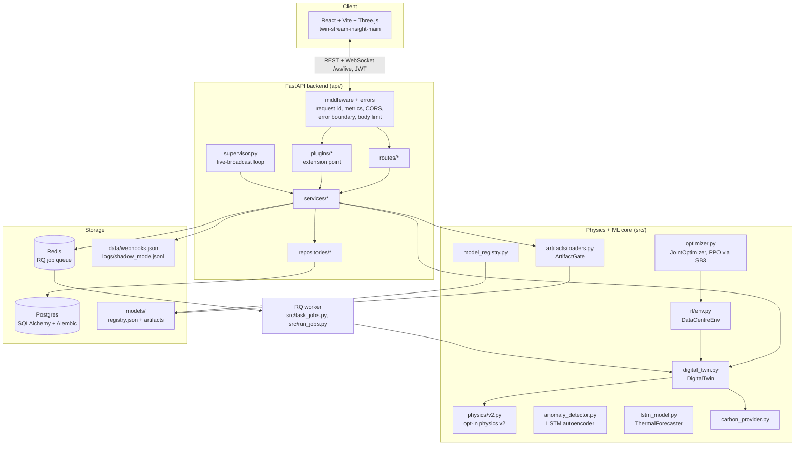

# System Architecture

TwinGrid is a **simulation-based** data-centre digital twin. Every number the
platform produces comes from the in-repo physics simulator (`src/digital_twin.py`);
nothing is measured from a real facility, and the three ML models are trained on
data generated by that same simulator (`docs/model_cards/LIMITATIONS.md`).

This file describes the code as it is. Anything not implemented is listed under
[Not built](#not-built). Request-time and training-time flows are in
`data_flow.md`; deployment is in `deployment.md`; extension points are in
`extension_points.md`.

## Layout

| Path | Role |
|---|---|
| `api/main.py` | Composition root: routers, middleware, lifespan (DB init, supervised broadcast loop, optimizer warm-up). |
| `api/routes/` | Thin HTTP handlers: `digital_twin`, `scenario`, `run`, `evaluation`, `optimization`, `anomaly` (alerts, webhooks), `shadow_mode`, `esg_report`, `equipment_health`, `facility`, `telemetry`, `health` (`/livez`, `/readyz`), `metrics`, `websocket`. `api/auth.py` adds the auth routes. |
| `api/services/` | Business logic and singletons: shared live twin (`twin_service`), live broadcast, anomaly pipeline, optimizer, runs, scenario registry, evaluation projection, telemetry window, audit, webhooks, ESG report, shadow mode, facility. |
| `api/repositories/` | All DB access (`data_repository`, `facility_repository`). |
| `api/plugins/` | Extension point (Task 1); see `extension_points.md`. |
| `src/` | Physics (`digital_twin.py`, `physics/`), RL environment (`rl/`), optimizer, ML models, data generation, ingestion, telemetry storage, artifact gate, model registry, task queue. |
| `models/` | Model artifacts and `registry.json`; `models/db_models.py` holds the SQLAlchemy ORM models. |
| `alembic/versions/` | 10 revisions, one head (`20261004000000`). |
| `twin-stream-insight-main/` | React frontend (own `package.json`, tests, docs under `docs/frontend/`). |

## Physics

- **`DigitalTwin` is the one physics implementation.** The live API path, the
  what-if/simulate computations, the historical-dataset generator
  (`src/data_generator.py`, `_simulate` calls the twin's own methods) and the RL
  environment (`src/rl/env.py` builds a fresh `DigitalTwin` on each `reset()`) all
  go through it.
- **Versions** (`src/versions.py`): `legacy-0` (original model, kept for replay),
  `1` (the default, `PHYSICS_VERSION = "1"`) and `2` (opt-in dynamic lumped-capacitance
  model, `PHYSICS_VERSION=2`; see `docs/PHYSICS_V2.md`). The constants are proposed
  engineering values, **not calibrated to a real facility**.
- **Cooling-mode rule:** `select_cooling_mode` forces closed-loop cooling when
  water stress exceeds `DROUGHT_THRESHOLD = 0.7`. The same threshold is enforced
  by the RL safety shield (`src/rl/safety_filter.py`).
- **Carbon:** `src/carbon_provider.py` supplies the intensity curve. With no
  `data/cleaned/carbon_intensity.csv` (not present in this repository) it uses a
  **flat 475 gCO2/kWh assumption** and labels it `constant_assumption` /
  `is_fallback=True`; the live payload carries `carbon_data_is_real`,
  `carbon_semantic` and `carbon_is_fallback`.
- `src/digital_twin_optimized.py` is a separate batch/JIT variant used by
  `benchmark_performance.py` and tests only; the API does not use it.

## ML models and artifacts

- **Forecaster** (LSTM, `src/lstm_model.py`), **anomaly detector** (LSTM
  autoencoder, `src/anomaly_detector.py`, 12-step window of 5 features) and
  **PPO cooling optimizer** (`src/optimizer.py` + `src/rl/`). Model cards:
  `docs/model_cards/`.
- **Every model load goes through `ArtifactGate`** (`src/artifacts/loaders.py`):
  status, SHA-256 integrity, version compatibility, file-format allow-list.
  `tests/test_artifact_gate.py` enforces that nothing else loads models.
- **The API image has no PyTorch or stable-baselines3** (they live in
  `requirements-train.txt`). `POST /api/optimize` serves only a `promoted`,
  compatible policy through the NumPy runtime (`src/rl/numpy_policy.py`) and
  answers `503 model_unavailable` otherwise; it never trains.
- `models/registry.json` is the lineage log (`src/model_registry.py`);
  `scripts/registry_cli.py` promotes candidates.

## Persistence

- **Postgres** (SQLAlchemy async + Alembic): `users`, `refresh_tokens`,
  `audit_logs`, `sensor_readings`, `simulation_runs`, `optimization_results`,
  `alerts`, and the facility/telemetry tables `facility`, `asset`, `asset_edge`,
  `asset_pose`, `sensor`, `telemetry_sample`. Rows carry `origin`; the simulator
  writes `simulated`, never `measured`.
- **Redis**: the RQ queue behind `POST /api/optimize/train_async` and
  `POST /api/runs`. Run state lives in Redis only (no table).
- **Files**: `models/registry.json`, `data/webhooks.json` (alert subscribers),
  `logs/shadow_mode.jsonl` (PPO-vs-baseline samples).

## Cross-cutting

- **Auth**: JWT access + rotating refresh tokens (`api/auth.py`), roles
  viewer/operator, audit log (`api/services/audit_service.py`).
- **Errors**: one `application/problem+json` contract (`api/errors.py`); no
  tracebacks in responses.
- **Reliability**: the live loop runs under `api/supervisor.py`; `/livez` and
  `/readyz` report it. Rate limiting (`api/rate_limit.py`), request-size limit,
  Prometheus `/metrics` (token-protected).
- **Startup checks**: `api/startup_checks.py`.

## Frontend

`twin-stream-insight-main/` (React, Vite, TypeScript, Three.js). Routes in
`src/App.tsx`: `/` (live twin), `/analytics`, `/runs`, `/evaluation`,
`/telemetry`, plus feature-module routes (`src/features/`). It talks to the API
through `src/api/apiClient.ts` (REST) and `src/api/wsTransport.ts`
(`/ws/live`, connects with `?token=`). Feed state is in `src/telemetry/`, the
3D scene in `src/three/`.

## Not built

Real facility integration through BACnet/Modbus/SNMP, multi-tenancy, fleet
management, SOC 2, CAD import, Kubernetes, multi-region deployment, cost/FinOps
monitoring. An opt-in MQTT ingest service (`src.sensor_ingestion`, compose profile
`mqtt`) exists, but no broker is bundled and nothing here claims a real facility
is connected. The product has never been deployed to a hosting platform
(`deployment.md`).
