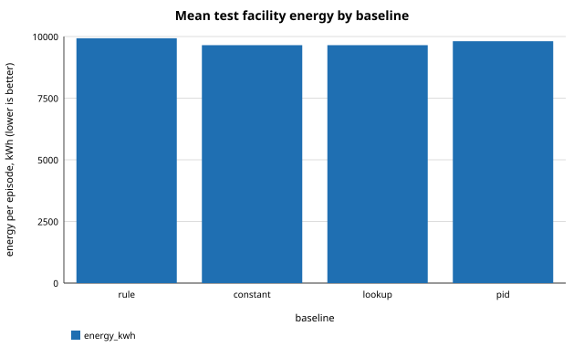
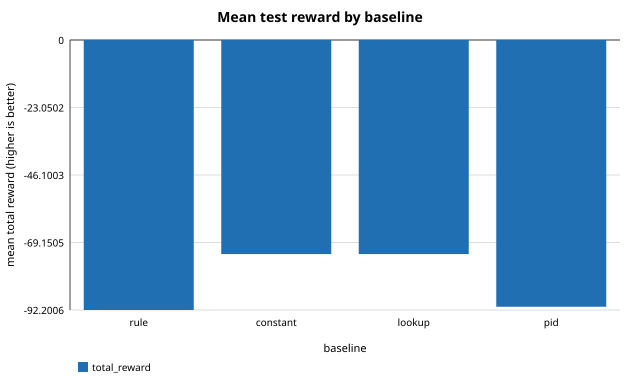

# Deterministic baselines v2: held-out evaluation

Experiment: `baselines`
Schema: `twingrid-results/1`
Seeds: 200000, 200001, 200002, 200003, 200004, 200005, 200006, 200007, 200008, 200009, 200010, 200011, 200012, 200013, 200014, 200015, 200016, 200017, 200018, 200019

Generated from `results.json` by `src/repro/report.py`; nothing in this file is typed by hand.

## Summary

| metric | value |
|---|---|
| baselines_evaluated | 4 |
| baselines_infeasible | 0 |
| mean_test_reward_constant | -73.1082 |
| mean_test_reward_lookup | -73.1082 |
| mean_test_reward_pid | -91.0886 |
| mean_test_reward_rule | -92.2006 |
| test_scenarios | 60 |
| validation_scenarios | 30 |

## Baselines: tuning outcome on validation

| baseline | status | validation_reward | validation_violation_steps | parameters |
|---|---|---|---|---|
| rule | feasible | -92.1649 | 0 | production mode rule at 12 C |
| constant | feasible | -73.1079 | 0 | 15 C, closed_loop |
| lookup | feasible | -73.1079 | 0 | 5 x 5 bins (25 cells, 7 fallback) |
| pid | feasible | -91.0515 | 0 | target inlet 22 C, kp=1, ki=0, kd=0, mode rule production_rule |

Full precision: `tables/baselines.csv`

## Held-out test scenarios: mean total reward by scenario family

| baseline | stress_0.0 | stress_0.4 | stress_0.8 |
|---|---|---|---|
| rule | -101.737 | -100.914 | -73.9509 |
| constant | -73.1082 | -73.1082 | -73.1082 |
| lookup | -73.1082 | -73.1082 | -73.1082 |
| pid | -100.506 | -99.6516 | -73.1082 |

Full precision: `tables/test_reward_by_family.csv`

## Held-out test scenarios: mean per episode

| baseline | total_reward | energy_kwh | water_L | carbon_gco2 | mean_pue | mean_wue | outlet_violation_steps | inlet_over_max_steps | inlet_under_min_steps |
|---|---|---|---|---|---|---|---|---|---|
| rule | -92.2006 | 9929.63 | 5007.95 | 4.71657e+06 | 1.27511 | 0.651197 | 0 | 0 | 0 |
| constant | -73.1082 | 9649.78 | 462.741 | 4.58365e+06 | 1.23924 | 0.0600073 | 0 | 0 | 0 |
| lookup | -73.1082 | 9649.78 | 462.741 | 4.58365e+06 | 1.23924 | 0.0600073 | 0 | 0 | 0 |
| pid | -91.0886 | 9809.33 | 4946.45 | 4.65943e+06 | 1.25976 | 0.643281 | 0 | 0 | 0 |

Full precision: `tables/test_summary.csv`

## Mean test facility energy by baseline

## Mean test reward by baseline

## Notes

- Four deterministic baselines tuned on validation are evaluated on held-out scenarios.
- Not optimal control: the grids and bins are coarse and everything is tuned and evaluated inside the simulator.
- MPC is not implemented (contract section 13.8): a perfect-model controller would be an oracle upper bound, not a deployable baseline.
- All four use the same actuator limits, the same environment, scenarios and envelope; the scenario-input hash is identical across policies.
- On validation the lookup table did not improve on the best constant over the same action grid; the exhaustive per-bin search kept the constant action in the bins it filled.
