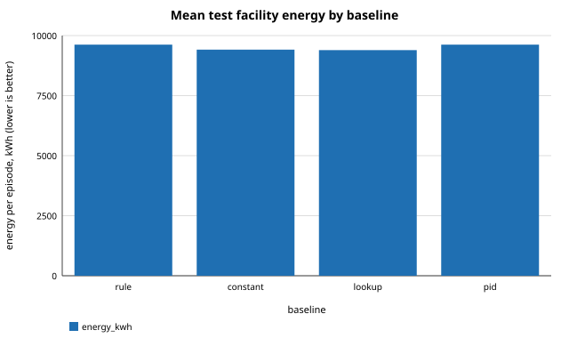
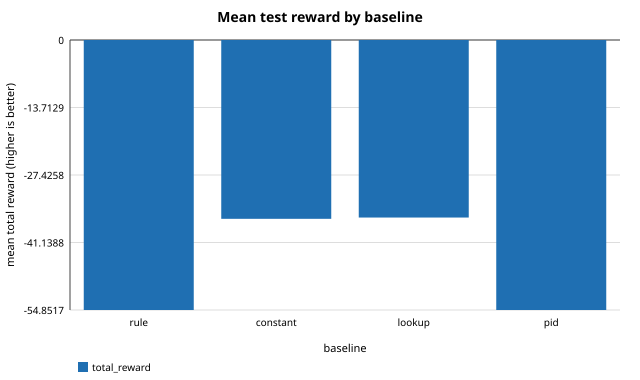

# Deterministic baselines v2: held-out evaluation

Experiment: `baselines`
Schema: `twingrid-results/1`
Seeds: 200000, 200001, 200002, 200003, 200004, 200005, 200006, 200007, 200008, 200009, 200010, 200011, 200012, 200013, 200014, 200015, 200016, 200017, 200018, 200019

Generated from `results.json` by `src/repro/report.py`; nothing in this file is typed by hand.

## Summary

| metric | value |
|---|---|
| baselines_evaluated | 4 |
| baselines_infeasible | 0 |
| mean_test_reward_constant | -36.3272 |
| mean_test_reward_lookup | -36.0675 |
| mean_test_reward_pid | -54.229 |
| mean_test_reward_rule | -54.229 |
| test_scenarios | 60 |
| validation_scenarios | 30 |

## Baselines: tuning outcome on validation

| baseline | status | validation_reward | validation_violation_steps | parameters |
|---|---|---|---|---|
| rule | feasible | -54.1855 | 0 | production mode rule at 12 C |
| constant | feasible | -36.3247 | 0 | 12.5 C, closed_loop |
| lookup | feasible | -36.0686 | 0 | 5 x 5 bins (25 cells, 7 fallback) |
| pid | feasible | -54.1855 | 0 | target inlet 22 C, kp=0, ki=0, kd=0, mode rule production_rule |

Full precision: `tables/baselines.csv`

## Held-out test scenarios: mean total reward by scenario family

| baseline | stress_0.0 | stress_0.4 | stress_0.8 |
|---|---|---|---|
| rule | -63.5961 | -62.6451 | -36.4457 |
| constant | -36.3272 | -36.3272 | -36.3272 |
| lookup | -36.0675 | -36.0675 | -36.0675 |
| pid | -63.5961 | -62.6451 | -36.4457 |

Full precision: `tables/test_reward_by_family.csv`

## Held-out test scenarios: mean per episode

| baseline | total_reward | energy_kwh | water_L | carbon_gco2 | mean_pue | mean_wue | outlet_violation_steps | inlet_over_max_steps | inlet_under_min_steps |
|---|---|---|---|---|---|---|---|---|---|
| rule | -54.229 | 9568.78 | 4823.47 | 4.54517e+06 | 1.22905 | 0.627444 | 0 | 0 | 0 |
| constant | -36.3272 | 9414.43 | 451.45 | 4.47185e+06 | 1.20914 | 0.0585493 | 0 | 0 | 0 |
| lookup | -36.0675 | 9394.39 | 450.456 | 4.46233e+06 | 1.20555 | 0.0583709 | 0 | 0 | 0 |
| pid | -54.229 | 9568.78 | 4823.47 | 4.54517e+06 | 1.22905 | 0.627444 | 0 | 0 | 0 |

Full precision: `tables/test_summary.csv`

## Mean test facility energy by baseline

## Mean test reward by baseline

## Notes

- Four deterministic baselines tuned on validation are evaluated on held-out scenarios.
- Not optimal control: the grids and bins are coarse and everything is tuned and evaluated inside the simulator.
- MPC is not implemented (contract section 13.8): a perfect-model controller would be an oracle upper bound, not a deployable baseline.
- All four use the same actuator limits, the same environment, scenarios and envelope; the scenario-input hash is identical across policies.
