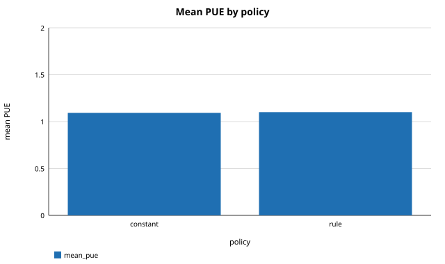
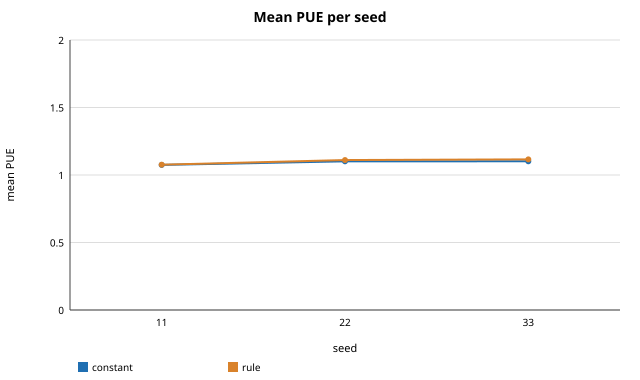

# Toy dummy-policy experiment

Experiment: `toy`
Schema: `twingrid-results/1`
Seeds: 11, 22, 33

Generated from `results.json` by `src/repro/report.py`; nothing in this file is typed by hand.

## Summary

| metric | value |
|---|---|
| episodes_total | 18 |
| mean_pue_constant | 1.09251 |
| mean_pue_difference_rule_minus_constant | 0.00846005 |
| mean_pue_rule | 1.10097 |

## Paired PUE difference, rule minus constant

| episodes | mean_difference | std_difference | episodes_rule_better |
|---|---|---|---|
| 18 | 0.00846005 | 0.0103564 | 2 |

Full precision: `tables/paired_difference.csv`

## Mean PUE and water per seed

| seed | policy | mean_pue | mean_water |
|---|---|---|---|
| 11 | constant | 1.07473 | 0.2 |
| 11 | rule | 1.07639 | 0.177917 |
| 22 | constant | 1.10127 | 0.2 |
| 22 | rule | 1.11075 | 0.191001 |
| 33 | constant | 1.10154 | 0.2 |
| 33 | rule | 1.11579 | 0.19812 |

Full precision: `tables/per_seed.csv`

## Policy summary across seeds

| policy | mean_pue | std_pue_across_seeds | mean_water |
|---|---|---|---|
| constant | 1.09251 | 0.0153993 | 0.2 |
| rule | 1.10097 | 0.0214401 | 0.189013 |

Full precision: `tables/policy_summary.csv`

## Mean PUE by policy

## Mean PUE per seed

## Notes

- Synthetic scenarios and a made-up cooling formula; this experiment only exercises the reproducibility framework.
